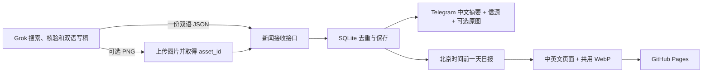

# Grok → AI Daily v2

这版只接收 Grok 已整理的新闻。服务端不运行旧的信息源采集器、不调用 OpenAI、Embedding 或付费大模型，也不补拍截图。旧采集代码仍保留，以便回退；是否停掉服务器上的旧定时任务，需要部署时单独确认。



## 展示和图片存储

- **Telegram：**每个事件一条中文消息，短标题、80–150 字摘要、信源；有图则带图文说明，无图则文字消息。长正文不塞进频道。
- **网站：**每天中英文各一篇日报，两个语言页面对应同一批事件。目录、摘要、信源和图片可直接浏览；全文点击展开。按服务器实际接收日归档，迟到稿件进入收到当天，避免漏稿。
- **外部文章、论文、公告：**只给原始信源链接，不截图。
- **X 原生消息：**最多一张原文截图，不翻译。必须一次完整且清晰；长推文放不下、被登录墙挡住或失败，直接略过图片，正文和链接照常接收。
- **原始 PNG：**保存在服务器 `NEWS_DATA_DIR/images/`，供 Telegram 上传及备份；不会加入 Git。
- **网站图片：**生成最大宽度 1280px、质量 86 的 WebP，路径 `site/public/news-shots/<hash>.webp`，中英文共用同一文件。每日发布时和两份日报一起提交 GitHub，网站使用自己的 `/news-shots/...`，不依赖临时 Grok 链接或 `raw.githubusercontent.com`。

GitHub 不是无限容量图床。[GitHub Pages 官方限制](https://docs.github.com/en/pages/getting-started-with-github-pages/github-pages-limits)为发布站点最多 1 GB。实际体积取决于截图；例如每天 5 张、每张压缩后 200 KB，约 30 MB/月。如果后续图片增长较快，再迁移到对象存储。当前不额外引入图床费用或凭据。

## 本地启动

在仓库根目录，使用独立 Python 3.11+ 环境：

```sh
python3 -m venv .venv-intake
.venv-intake/bin/pip install -r requirements-intake.txt
.venv-intake/bin/python -m src.intake serve --local-demo --data-dir data/grok-intake
```

打开 `http://127.0.0.1:8787/` 看工作台，`/docs` 看接口。无鉴权演示模式只允许回环连接。默认不运行浏览器截图、不发送 Telegram。`--legacy-screenshots` 仅用于旧版本兼容。

正式服务设置至少 32 字符随机 `NEWS_WEBHOOK_TOKEN`，去掉 `--local-demo`，通过 HTTPS 反向代理连接本机 8787。Grok 的运行环境必须能发 HTTP 请求并能拿到真实截图文件；在聊天中展示图片不代表文件已经上传。公网地址、认证和真实 Grok 调用需要部署后联调。

## 接口：一次提交两种语言

`POST /api/v2/news` 接收同一事件的中英版本。不要把中文、英文分别提交成两条新闻。

通用请求头：

```http
Authorization: Bearer <NEWS_WEBHOOK_TOKEN>
Content-Type: application/json
```

完整可执行结构见 [`examples/grok-bilingual.json`](../examples/grok-bilingual.json)。这是明确标记的演示数据，不能当作真实新闻发送到公开频道。

| 字段 | 规则 |
| --- | --- |
| `schema_version` | `"2"` |
| `run_id` | 每轮唯一；失败重试保留同一个值和完全相同的内容 |
| `generated_at` | 真实生成时间，ISO 8601，必须带时区 |
| `items` | 1–30 条，整个 JSON 最多 1 MB；没有新事件则不提交 |
| `event_key` | 稳定事件标识，如 `vendor-product-version-release-20261109`；改写标题不换 key |
| `story_type` | `external` 或 `x` |
| `title_zh` / `title_en` | 两种语言标题；上限 200 / 300 字符 |
| `summary_zh` / `summary_en` | 中文建议 80–150 字，上限 240；英文建议 40–70 词，上限 600 字符 |
| `body_zh` / `body_en` | 完整报道，纯文本，用两个换行分段；上限 16000 / 24000 字符。不要包含内部运行报告 |
| `tweet_url` | `x` 类型必填原帖 URL；外部文章可选 |
| `sources` | 1–12 个 `{label, url, dedup}`，必须是具体原始信源的 HTTP(S) URL；首页、汇总页等设 `dedup:false` |
| `published_at` | 信源的真实发布时间，带时区；没有精确时间就 `null` |
| `published_date` | 只知道日期时填 `YYYY-MM-DD`；未知则 `null`，不猜 00:00 |
| `occurred_at` | 事件实际发生时间，可空；不要混同发帖时间 |
| `screenshot_asset_id` | 上传成功返回的 ID；没有截图则 `null` |
| `uncertainties` / `uncertainties_en` | 对应语言的待核实事项数组；摘要与正文也应保留关键限定条件 |

收到 `202` 代表已入库，不代表事实已核验、Telegram 已发送或网站已发布：

```json
{"run_id":"R20261109-1500","replayed":false,"accepted":["news_id"],"duplicates":[]}
```

`accepted` 进入发送队列；`duplicates` 不重复发布。重复事件有内容变化时 `needs_review:true`，完整来稿保留在运行记录里，不会自动覆盖旧稿。此版没有自动纠错或编辑已发频道消息；需要确认后另行处理。

去重只花本地计算：推文 ID、稳定 event_key、去掉跟踪参数的具体信源 URL，以及已知发布日期的标准化中文标题。没有语义向量库；完全不同信源和 key 的同一事件可能漏判，故 Grok 应先参考最近事件列表。

## PNG 怎么传

第一步直接上传文件二进制，**不是图片网址、聊天附件 ID、Base64 或 Markdown 图片**：

```http
POST /api/assets?kind=x_original&source_url=<URL编码后的原推文地址>
Authorization: Bearer <NEWS_WEBHOOK_TOKEN>
Content-Type: image/png

<PNG 文件的原始二进制>
```

例如环境变量已在运行环境安全配置后：

```sh
curl --fail-with-body -X POST \
  "$BASE_URL/api/assets?kind=x_original&source_url=https%3A%2F%2Fx.com%2Fjack%2Fstatus%2F20" \
  -H "Authorization: Bearer $NEWS_WEBHOOK_TOKEN" \
  -H 'Content-Type: image/png' \
  --data-binary @screenshot.png
```

成功返回 `201` 和 `asset_id`、宽高、字节数。PNG 上限 8 MiB，宽 200–2400、高 100–10000、总像素不超过 1600 万。只检查文件与来源绑定，服务端无法据此证明截图内容真实或完整。

第二步把返回的 `asset_id` 写入对应新闻的 `screenshot_asset_id`，再提交双语 JSON：

```sh
curl --fail-with-body -X POST "$BASE_URL/api/v2/news" \
  -H "Authorization: Bearer $NEWS_WEBHOOK_TOKEN" \
  -H 'Content-Type: application/json' \
  --data-binary @news.json
```

重复上传同一图片和来源返回相同 ID；原图不会重复存储。截图必须绑定这条新闻的 `tweet_url`。`external` 类型不接受图片 ID。v2 没有图就跳过，不排队重拍。上传失败时可选择不带图提交，但**已提交后的重试不能擅自改变同一 run_id 的内容**；超时先查运行记录。

| 辅助接口（同样要鉴权） | 用途 |
| --- | --- |
| `GET /api/feed/zh` | 最近 100 条中文事件，含 event_key、信源和图片地址 |
| `GET /api/feed/en` | 同一批事件的英文内容 |
| `GET /api/runs/{run_id}` | 确认某轮是否已入库，查看原请求和去重结果 |
| `GET /api/items/{id}/image` | 取回原始 PNG；供受鉴权客户端使用，不直接作为公开网站图床 |
| `GET /api/items/{id}/telegram-preview` | 查看将发送的中文 HTML 文本，**不发送** |
| `GET /api/telegram/outbox` | 查看 pending / sending / sent / failed / uncertain 状态 |

401 检查接入密钥；413 缩小图片或请求；422 按错误字段修正；409 代表 run_id 已有不同内容，先查看运行记录，不要盲目换 ID 重推。

## Telegram 启用及失败处理

创建 Bot 和频道后，将 Bot 设为频道管理员并授权发帖。在服务器受保护环境文件中设置 `TELEGRAM_BOT_TOKEN`、`TELEGRAM_CHANNEL_ID`（`@频道名` 或 `-100...`），服务启动增加 `--telegram`。不要把密钥放进 Git、Grok 正文或公开页面。

显式启用后会处理**已有 pending 队列**，所以正式接入用干净生产数据目录，不要复用演示库。频道仍只发中文：图片正常使用 `sendPhoto`，极端长宽比无法作为照片时降级为原图文件加说明；无图使用 `sendMessage`。[Telegram 官方文档](https://core.telegram.org/bots/api#sendphoto)限制照片说明最多 1024 字符，程序保守限制文本并对 HTML 转义。

明确的 429 按 `retry_after` 延迟重试，最多 5 次；明确拒绝标记 failed；网络超时、异常响应或发送中重启标记 uncertain，不自动重发。检查频道实际消息后再决定人工补发，不能只看 HTTP 请求失败就断言未送达。

## 日报生成与发布

```sh
# 默认取昨天，按 Asia/Shanghai 的自然日计算
.venv-intake/bin/python -m src.intake digest --data-dir data/grok-intake --site site

# 指定补做日期，仅生成本地文件
.venv-intake/bin/python scripts/publish_grok_digest.py --date 2026-11-08
```

产出 `site/src/content/blog/grok-daily-YYYY-MM-DD-{zh,en}.md` 和共享图片，重复执行内容稳定。没有新闻不生成空日报。原始发布时间仅展示，日报归属以**接收时间**为准。v1 原型数据不进入 v2 日报。

在服务器专用的 main 分支、干净工作目录中，显式加 `--push` 才会提交这一天的两份日报及其引用图片并推送 main。会触发仓库已有 GitHub Pages workflow。不会提交整个仓库，不 force push，不自动 rebase；推送失败应检查 Git 状态。预览后文件未提交，目录非干净，不能直接再加 `--push`；先人工检查并处理本地修改。

`deploy/` 提供接收服务和北京时间每天 08:00 的 timer 示例。默认只生成文件，生产自动发布须把日报 service 的 ExecStart 改为带 `--push`，并配置最小权限 Git 凭据。不要同时运行旧 `run_and_push.sh` 与新日报发布任务。SQLite 和原图都需要备份；WebP 可以从原图重新生成。timer 重启补触发只生成当时的昨天，多天停机后的历史日期需要通过 --date 逐日补做。

2026-11-09 已在 ai-daily（43.133.59.36）部署接收服务和 Caddy HTTPS，详见 [当前部署状态](../deploy/production.md)。已用测试图文验证公网收稿、图片读回和重试去重；真实 Grok 工具调用尚待联调。Telegram 和网站日报自动发布尚未启用。


生产发布已改用 08:00 窗口：`--date` 表示发布日期。例如 `--date 2026-11-10` 汇总 11 月 9 日 08:00（含）至 11 月 10 日 08:00（不含）的入库消息。生产脚本使用独立 main 检出、`--github --push`，生成前同步远程，成功推送后记录进度。GitHub 原文简介单独展示，来源故障不会阻塞已核验的 Grok 新闻。详见 deploy/production.md。
